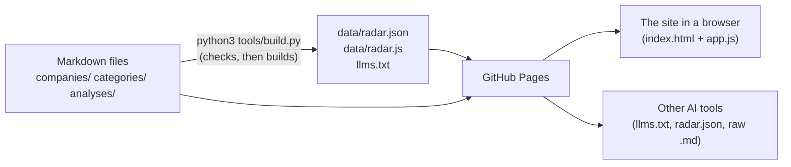

# How AEC Tech Radar works

## The big picture

There's no server and no database. The research lives in Markdown files
(plain text). Each starts with a block of labelled facts, such as `founded:`
and `ring:`; this block is called "front matter" and uses a format called
YAML. A Python script checks every file, then joins them into one data file.
GitHub Pages (GitHub's free web hosting) publishes the site, that data file
and the raw Markdown.

## What happens when you open the page
1. `index.html` loads `data/radar.js` (all the research, as a file the page
   can read), the two libraries in `vendor/`, then `app.js` (the code that
   draws the pages).
2. `app.js` reads the part of the web address after `#` (for example
   `#/company/buildots`) and draws that page from the research. Moving to
   another page doesn't reload anything.

## The core logic
- **Checks** (`tools/build.py`): each file has the fields it needs, of the
  right kind; values come from the allowed lists (rings, statuses and so on);
  its categories exist; it has at least two sources, all `https` web
  addresses, and at least one not written by the company; and a closed firm
  has no ring. If any file fails, the script writes nothing. The tests for
  these checks are in `tools/test_build.py`.
- **Safety in the page:** the page treats all research text as text, never
  as code (the `esc()` function does this). Markdown is turned into web-page
  formatting by a library called marked, then cleaned by another called
  DOMPurify, so it can't run anything harmful. Only `https` addresses become
  links.

## The files
| File | Its job |
|---|---|
| `companies/*.md`, `categories/*.md`, `analyses/*.md` | The research: the master copy |
| `tools/build.py` | Checks the research and builds the files below |
| `data/radar.json`, `data/radar.js`, `llms.txt` | Built from the research, never edited by hand: everything in one file (`.json` for tools, `.js` for the page), and an index for AI tools |
| `index.html`, `app.js`, `style.css` | The site |
| `vendor/` | Copies of two libraries: marked 12.0.2 (turns Markdown into page formatting) and DOMPurify 3.1.6 (removes anything harmful), from npm (a public library store) |
| `docs/METHOD.md` | How the research is done, and what each field means |
| `.claude/skills/research-firm/` | The `/research-firm` skill: Claude's instructions for researching a firm |
| `scripts/`, `.claude/settings.json`, `.claude/rules/` | The kit from Leo's playbook that hands work between phone and Mac (kept up to date automatically) |
| `docs/playbook-catch-up.md` | Which playbook rule changes this project has applied to its existing files |
| `.nojekyll` | Stops GitHub Pages turning the `.md` files into web pages, so AI tools can still read the plain text |

## What's stored where
| What | Where | Who can see it |
|---|---|---|
| The research | This repository (project folder on GitHub) | Anyone: it's public |
| The saved text of every page we cite, fetched daily by a GitHub Action (a job that runs on GitHub's computers) | The private repository `leo-hyde/AECTechRadar-sources` | Leo only |
| Anything about visitors | Nothing is stored | n/a |

## Outside services, limits and terms
| Service | Used for | Limits and terms |
|---|---|---|
| GitHub Pages | Hosting the site | Free for public repositories |
| Web search (in Claude sessions) | Research | Uses credits. Respect each source's terms; don't copy paid databases in bulk |

## Safety and security
- No secrets (passwords or keys), no logins, and no data about visitors.
- The repository is public, so no client names or notes (see CLAUDE.md).
- **Where it could mislead:** the facts and rings are AI drafts. Each page
  says so, shows when it was last checked, and links to its sources.

## How changes are checked
- `python3 tools/build.py --check` (the checks above, without building) and
  `python3 -m unittest discover tools` (the tests).
- The pages were checked with Playwright (a tool that drives a browser
  automatically) at phone width (375 pixels) and desktop width (1280), in
  light and dark mode: no sideways scrolling, no errors, and the filters
  work. That check script isn't in the repository yet.

## Weak spots
- The checks only confirm a source link is well formed, not that the page
  still exists.
- The browser check script isn't in the repository, and nothing runs it
  automatically.
- The Mac needs PyYAML installed (`pip3 install pyyaml`): the library
  `build.py` uses to read the front matter.
