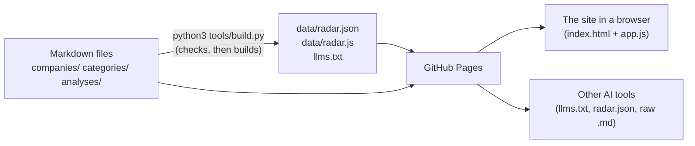

# How AEC Tech Radar works

## The big picture

No server and no database. The research lives in plain Markdown files with a
block of structured fields at the top (YAML "front matter"). A Python script
checks them and builds one combined data file. GitHub Pages serves the site,
the built files and the raw Markdown.

## What happens when you open the page
1. `index.html` loads `data/radar.js` (which sets `window.RADAR`), the two
   libraries in `vendor/`, then `app.js`.
2. `app.js` reads the part of the address after `#` (e.g. `#/company/buildots`)
   and draws that page from `window.RADAR`. Changing page doesn't reload.

## The core logic
- **Checks** (`tools/build.py`): required fields and types, allowed values
  (rings, statuses…), categories that exist, at least two https sources with
  at least one not by the company, closed firms only without a ring. Nothing
  is written if any file fails. Tests: `tools/test_build.py`.
- **Safety in the page:** every data value is escaped (`esc()`); Markdown is
  converted by marked and then cleaned by DOMPurify so it can't run scripts;
  only https links become links.

## The files
| File | Its job |
|---|---|
| `companies/*.md`, `categories/*.md`, `analyses/*.md` | The research (source of truth) |
| `tools/build.py` | Checks the research and builds the files below |
| `data/radar.json`, `data/radar.js`, `llms.txt` | Built: everything in one file (JSON for tools, JS for the page), and an index for AI tools |
| `index.html`, `app.js`, `style.css` | The site |
| `vendor/` | marked 12.0.2 (Markdown) and DOMPurify 3.1.6 (sanitiser), copied from npm |
| `docs/METHOD.md` | Research rules and field meanings |
| `.claude/skills/research-firm/` | The `/research-firm` skill |
| `scripts/`, `.claude/settings.json`, `.claude/rules/` | Playbook handover kit (synced) |
| `.nojekyll` | Stops GitHub Pages converting `.md` to HTML |

## What's stored where
| What | Where | Who can see it |
|---|---|---|
| Research | This repo | Anyone (public) |
| Nothing about visitors | n/a | n/a |

## Outside services, limits and terms
| Service | Used for | Limits and terms |
|---|---|---|
| GitHub Pages | Hosting | Free for public repos |
| Web search (in Claude sessions) | Research | Uses credits; respect each source's terms; don't bulk-copy paid databases |

## Safety and security
- No secrets, no logins, no visitor data.
- Public repo: no client names or notes (see CLAUDE.md).
- **Could mislead:** AI-drafted facts and rings. Each page labels drafts,
  shows the last-checked date and links to its sources.

## How changes are checked
- `python3 tools/build.py --check` and `python3 -m unittest discover tools`.
- Pages checked with Playwright at 375px and 1280px, light and dark (no
  sideways scroll, no script errors, filters work). The script isn't in the
  repo yet.

## Weak spots
- Source links are checked for format, not that they still work.
- The browser check script isn't in the repo or run automatically.
- PyYAML must be installed on the Mac (`pip3 install pyyaml`).
